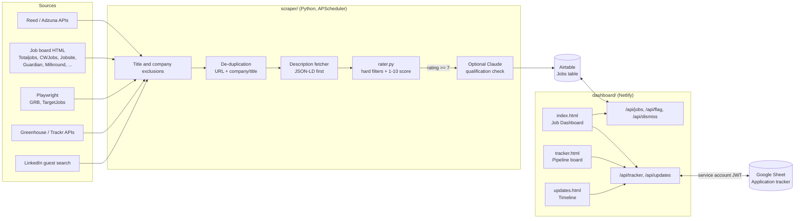
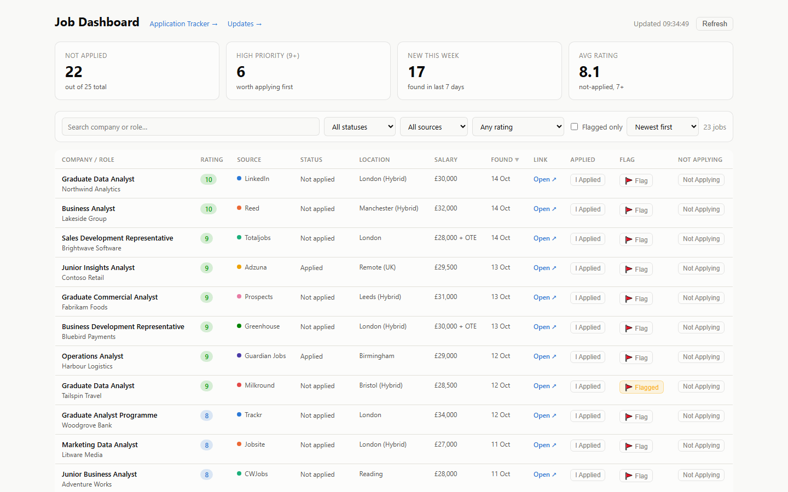
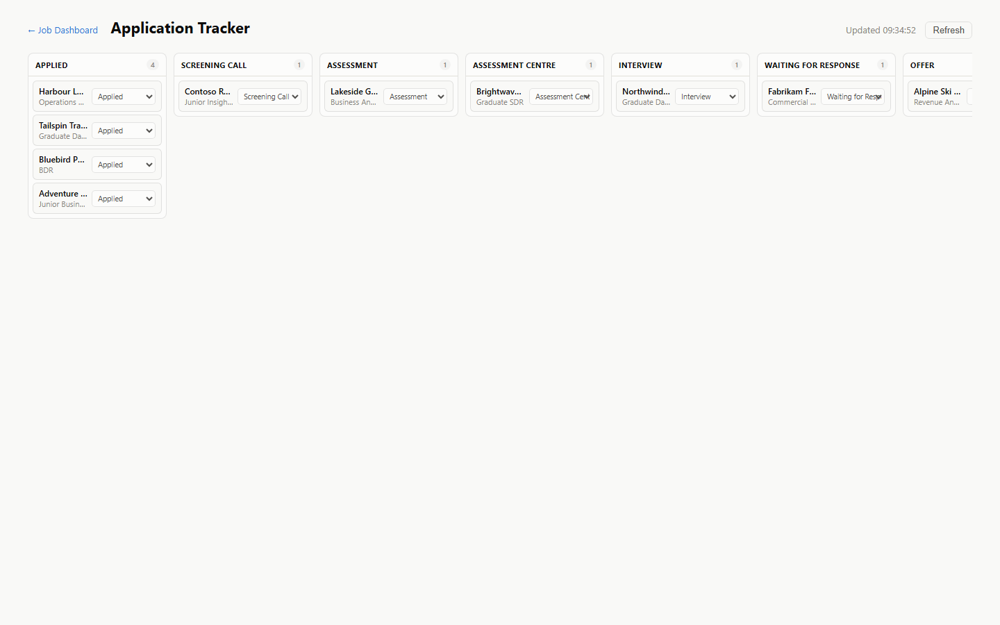
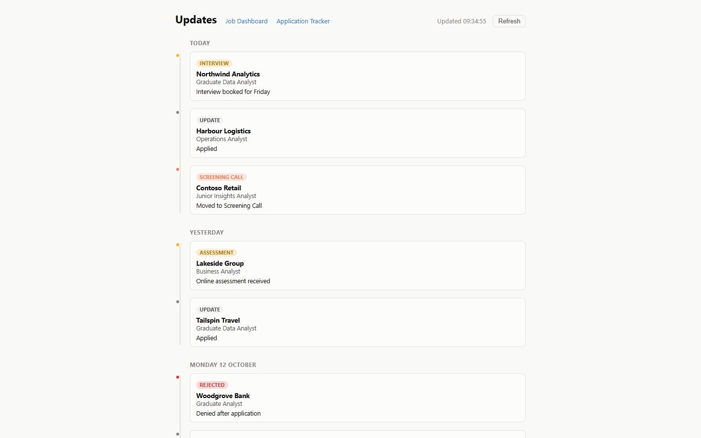

# Job Hunt Automation

**An end-to-end pipeline that scrapes 17 UK job sources, scores every listing against a candidate profile and serves the shortlist through a password-protected dashboard linked to an application tracker.**

## Why I built it

Hunting for a graduate role meant checking more than a dozen job boards every day, reading hundreds of adverts that turned out to want three years' experience, a STEM degree or a language I don't speak, then copying the promising ones into a spreadsheet by hand. I wanted to automate the whole graduate job hunt end to end: find every relevant listing as soon as it is posted, throw out the ones I can't apply for, rank the rest against my CV and track each application from "applied" through to "offer" in one place.

## Features

### Scraper (`scraper/`)

- **17 sources** collected on a schedule (every 3 hours by default):
  - **APIs:** Reed, Adzuna, Greenhouse company boards, Trackr (UK graduate programmes and off-cycle internships)
  - **HTML scraping (requests + BeautifulSoup):** Totaljobs, CWJobs, Jobsite, Guardian Jobs, Fish4Jobs, Milkround, Jora, S1Jobs, Prospects, Gradcracker
  - **Headless browser (Playwright):** GRB (Graduate Recruitment Bureau), TargetJobs
  - **LinkedIn** via the public guest search endpoint, limited to a curated keyword subset and throttled
- **Search matrix:** over 200 queries generated from seniority × sector combinations (e.g. "graduate" × "pricing analyst") plus hand-picked phrasings.
- **CV-matching rating system (1-10):** a transparent, rule-based scorer in `rater.py` (see Engineering highlights).
- **Hard eligibility filters:** a listing is rated 1 straight away if it needs years of experience, a specific prior role, an existing professional qualification (ACA/ACCA/CIMA etc.), current student status, a STEM-only degree, a manual driving licence, security clearance or a foreign language, or if it is in a non-English language or an excluded industry.
- **Optional AI second pass:** jobs that clear the keyword threshold can be sent to Claude (Haiku) to check minimum qualifications, returning qualifies / doesn't qualify / uncertain. Switched off by default (`ENABLE_AI_CHECK`) to keep running costs at zero.
- **Description enrichment:** search-result pages rarely include the full advert, so the full description is fetched lazily (schema.org `JobPosting` JSON-LD first, visible text as a fallback, login walls detected and discarded) only for jobs that survive the cheap filters.
- **De-duplication:** by URL and by company + normalised title (agency reference codes stripped), both pre-loaded from Airtable at the start of each run.
- **Airtable sync:** only jobs rated 7+ are written to Airtable with rating, rating notes, seniority match, source, salary, location and dates.
- **Maintenance scripts:** `retrate_airtable.py` re-scores the existing backlog after a rules change (re-fetching truncated descriptions and clearing stale flags); `backfill_adzuna_dates.py` repairs missing posting dates.

### Dashboard (`dashboard/`)

- **Job Dashboard (`index.html`):** stat tiles (not applied, high priority 9+, new this week, average rating), search, filters by status, source, rating and "flagged only", sorting and pagination.
- **One-click actions:** "I applied" adds the job to the Google Sheet tracker and marks it Applied in Airtable (with undo); "Not applying" soft-dismisses it; "Flag" records why a rating looks wrong (underqualified, too high, too low, wrong sector) so the rules can be tuned.
- **Application Tracker (`tracker.html`):** a Kanban-style pipeline (Applied → Screening → Assessment → Assessment Centre → Interview → Waiting → Offer / Rejected) built from the sheet's status column, with stage changes written back to the sheet.
- **Updates (`updates.html`):** a dated timeline of every change from the sheet's "Daily Changes Log" tab.
- **Five serverless functions** (Netlify Functions, TypeScript): `/api/jobs`, `/api/flag`, `/api/dismiss`, `/api/tracker`, `/api/updates`.
- **Auth:** every function checks a shared password sent in an `x-dashboard-key` header; every response is `private, no-store` so the CDN can never serve cached data to an unauthenticated request.

### Tracker integration

The tracker is a Google Sheet with an `Assignments` tab (company, role, status, deadline, notes) and a `Daily Changes Log` tab. The `/api/tracker` function authenticates as a Google service account (a hand-signed RS256 JWT, no Google SDK) and supports read, append, update, upsert by company + role, undo (clear row) and heartbeat log entries. The upsert mode lets an external routine (for example one that reads application emails) update statuses without knowing row numbers.

## Architecture



## Tech stack

| Area | Tools |
| --- | --- |
| Scraper | Python 3.10+, requests, BeautifulSoup + lxml, Playwright (Chromium), APScheduler, python-dotenv |
| Scoring | Regex/keyword rules engine; optional Anthropic Messages API (Claude Haiku) |
| Data | Airtable REST API, Google Sheets API v4 |
| Dashboard | Vanilla HTML/CSS/JS, Netlify Functions (TypeScript `.mts`), Node `crypto` for JWT signing |

## Engineering highlights

- **Explainable scoring instead of a black box.** The 1-10 rating is a sum of weighted components (seniority up to 3, CV keyword alignment up to 3, title/role match up to 2, salary 1, location 1, plus a graduate-title bonus) minus penalties for tech-heavy, foreign-language, wrong-industry or "manager without a junior qualifier" listings. Listings that never state a seniority level are capped at 5 unless both CV alignment and role match are strong. Every rating is stored with human-readable notes explaining it.
- **Hard filters that read like a recruiter would.** Experience requirements are caught in many phrasings ("2+ years", "two to four years'", "6-18 months'", "Experience Required: 2-5 years", "a year of experience") with negation guards ("not required", "preferred", "no prior experience? no problem"), disjunction guards ("internship or prior experience", "STEM subject or Economics") and employer-context guards ("our leadership team has a proven track record") to avoid false exclusions.
- **Word-boundary-safe matching.** `matching.py` compiles every keyword into a `\b`-anchored regex, fixing a class of bugs where "intern" matched "international", "cto" matched "factory" and "ey" matched "they".
- **Cheap filters first, expensive work last.** Exclusions and de-duplication run before any extra HTTP request; the full description is only fetched for survivors; the paid AI check only runs on jobs that already score 7+. GRB skips detail-page visits for URLs already in Airtable.
- **Concurrency with politeness.** The ten keyword-based site scrapers plus Reed and Adzuna run concurrently per keyword in a thread pool (cutting a full cycle from roughly 6-7 hours to inside the 3-hour schedule), while LinkedIn stays sequential with a fixed delay, a page cap and a back-off on HTTP 429.
- **Robust by default.** Every scraper catches its own errors so one broken site never stops a run; the AI check fails open; Airtable writes retry without the date field if Airtable rejects its format; a single-instance file lock prevents overlapping runs; the Sheets append avoids Google's table-detection heuristic by computing the next row itself, after concurrent appends were found to interleave columns. The dashboard also queues tracker writes so they never race.
- **Small, consistent serverless API.** Each function validates auth, method and body, returns JSON errors with upstream detail (401/400/405/500/502) and never caches.

## Screenshots

From the dashboard's demo mode (`python dashboard/demo_server.py`): all companies and jobs are fictional.

| Job dashboard | Application tracker |
|---|---|
|  |  |



## Try the demo

The dashboard can be run with realistic but entirely fake data. No Netlify, Airtable or Google account is needed, only Python 3:

```bash
cd dashboard
python demo_server.py
```

Then open http://127.0.0.1:8798 and log in with any password. `demo_server.py` serves the three pages and answers the same `/api/jobs`, `/api/tracker`, `/api/updates`, `/api/flag` and `/api/dismiss` routes as the Netlify functions with 25 invented jobs, a tracker of 12 applications and a timeline of updates, all dated relative to today. Flagging, dismissing, "I applied" and moving tracker cards work in memory until you stop the server with Ctrl+C.

## Setup

### Scraper

```bash
cd scraper
python -m venv .venv
source .venv/bin/activate        # Windows: .venv\Scripts\activate
pip install -r requirements.txt
playwright install chromium

cp .env.example .env              # fill in Airtable (and optionally Reed, Adzuna, Anthropic) keys
cp profile.example.json profile.json   # describe your own candidate profile
python main.py                    # runs once, then every RUN_INTERVAL_HOURS
```

The Airtable `Jobs` table needs these fields: Job Title, URL, Source, Keywords, Date Found, Date Posted, Company, Location, Salary, Description, Rating (number), Seniority Match, Rating Notes, Status (single select including "Not applied", "Applied" and "Rejected by me"), Flag Category and Flag Note.

Search keywords, exclusions and scoring weights live in `config.py` and `rater.py`. Everything about the candidate (degree, target salary, preferred locations, languages, driving licence, experience) comes from the profile JSON.

### Dashboard

```bash
cd dashboard
npm install
cp .env.example .env              # for local development only
npx netlify dev                   # serves the pages and /api/* functions locally
```

To deploy, link the folder to a Netlify site and set the same variables (see `.env.example`) in the site's environment settings. Share the Google Sheet with the service account's email address. The sheet needs an `Assignments` tab (columns A-E: Company, Role, Status, Deadline, Notes, with a header row) and a `Daily Changes Log` tab (columns A-D: Date, Company, Role, Change).

## Project structure

```
job-hunt-automation/
├── scraper/
│   ├── scrapers/              # one module per source + description fetcher
│   ├── main.py                # scheduler, filtering, de-duplication, Airtable writes
│   ├── config.py              # search keywords, exclusions, env and profile loading
│   ├── rater.py               # rules-based 1-10 scoring and hard filters
│   ├── matching.py            # word-boundary-safe keyword matching
│   ├── qualification_checker.py   # optional Claude second pass
│   ├── airtable_client.py
│   ├── retrate_airtable.py    # re-score the backlog after rule changes
│   ├── backfill_adzuna_dates.py
│   ├── profile.example.json   # fictional example candidate
│   ├── requirements.txt
│   └── .env.example
├── dashboard/
│   ├── netlify/               # functions/: jobs, flag, dismiss, tracker, updates
│   ├── index.html             # Job Dashboard
│   ├── tracker.html           # Application pipeline board
│   ├── updates.html           # Changes timeline
│   ├── demo_server.py         # Demo mode: fake data, any password, port 8798
│   ├── netlify.toml
│   ├── package.json
│   └── .env.example
├── docs/
│   └── screenshots/
├── LICENSE
└── README.md
```

## Privacy

This public copy contains no personal data. The candidate in `profile.example.json` is fictional; the real profile, CV, cover letters, scraped job data, application history, logs and every credential are excluded by `.gitignore` and were never added to the repository. All API keys, base and sheet IDs and the dashboard password are read from environment variables. Company names that appear in code comments come from public job adverts that were used as test cases while tuning the rules.

## Licence

MIT. See [LICENSE](LICENSE).
